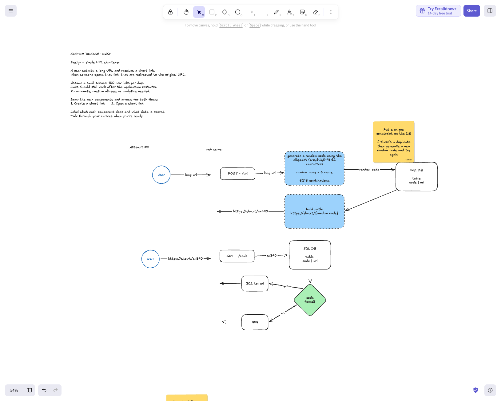

# URL shortener

**Topic:** System architecture · **Difficulty:** Easy

## Problem

Design a service that accepts a long URL, returns a short link, and redirects visitors to the original URL. Assume 100 new links per day and links must survive application restarts. No accounts, custom aliases, or analytics are required.

## Attempt 1

Justin drew separate create and lookup flows using a web server and Redis. The service hashes the URL, checks whether the key exists, and stores the key and original URL if absent. A lookup returns a 301 redirect or a 404.

**Score: 3.5/5.** The essential request flows, mapping, redirect, and missing-key case were present. The design did not explain how hashing produces a short code or handle a collision between different URLs; the save branch did not clearly return a complete short URL. Redis persistence needed an explicit configuration to meet the restart requirement.

**Feedback:** Return the full short URL, ensure key creation is atomic and handles collisions, and choose durable storage or explicitly configure Redis persistence.

## Attempt 2

After discussing the feedback, Justin revised the design to generate a six-character random code, store a `code | url` mapping in a SQL database, and return a short URL. A unique constraint and retry on duplicate protect the mapping. The lookup uses the code to return a 302 or 404.

**Score: 4/5.** This addresses the main gaps in the first attempt and is appropriately simple for the stated scale. The SQL table, collision retry, both request flows, and short-link construction are clear. The database write arrow is labeled only “random code”; explicitly show that the original URL is also inserted, and that the response is sent after a successful insert. A redirect response should place the stored destination in its `Location` header. The example code in the drawing has five characters although the generator specifies six; this is a notation inconsistency, not a design failure.

**Feedback:** Label the insert as `(code, long_url)`, enforce uniqueness on `code` at the database, retry after a duplicate, and return the complete short URL after the insert succeeds. Ensure the SQL database uses persistent storage.

[Both attempts on the canvas](both-attempts.png)

## Learning summary

Justin has demonstrated an ability to break a service into creation and lookup flows, choose a key/value mapping, and improve a design after feedback. In the revision, he applied random identifiers, a database uniqueness constraint with retry, and redirect handling. He asked useful questions about Redis persistence, random generation, uniqueness, and HTTP redirects; those topics were explained during the session, but independent mastery has not yet been tested.

---

2026-11-13 · Evaluated by GPT-6.1 Terra
